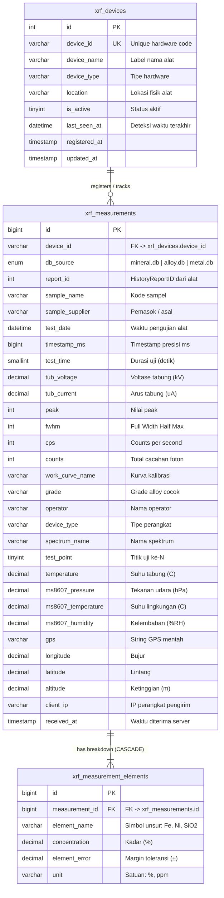

# Dokumentasi Teknis: Modul Data XRF (X-Ray Fluorescence)
**Sistem Informasi Laboratorium Mineral (SILAB - PT. AIS)**

---

## 1. Pendahuluan & Ringkasan Modul

Modul **Data XRF** di SILAB adalah subsistem integrasi yang menghubungkan instrumen spektrometer sinar-X portabel (*handheld/benchtop XRF Spectrometer*, seperti *XRF Explorer 7000* dan multi-unit `XRF01`–`XRF04`) dengan sistem manajemen laboratorium SILAB.

### Tujuan & Manfaat Utama
- **Otomasi Pengumpulan Data (*Auto Ingestion*)**: Menghilangkan proses input manual hasil penembakan scan mineral/logam oleh operator, mencegah kesalahan transkripsi (*human error*).
- **Audit & Pemantauan Instrumen Lengkap**: Menyimpan metadata pengukuran mentah secara komprehensif, mencakup parameter fisika tabung sinar-X ($kV, \mu A, \text{cps}$), kondisi lingkungan sensor MS8607 (suhu, kelembaban, tekanan), serta koordinat GPS lokasi pengambilan scan.
- **Integrasi Langsung ke Pengujian Sampel**: Analis laboratorium dapat langsung menarik (*fetch*) data scan XRF saat mengisi lembar pengujian di halaman `pengujian.php`, melakukan pencocokan kode sampel otomatis (*auto-suggest*), dan menghitung rata-rata (*averaging*) dari beberapa titik tembak (*scan titik 1, 2, dst.*).

---

## 2. Arsitektur & Alur Aliran Data (Data Pipeline)

```mermaid
flowchart TD
    subgraph Hardware ["1. Instrumen XRF Lapangan/Lab"]
        XRF["Alat XRF Explorer 7000\n(Android OS + SQLite)"]
        DB_LOKAL[("SQLite Lokal Alat\nmineral.db / alloy.db / metal.db")]
        XRF -->|Simpan scan| DB_LOKAL
    end

    subgraph MobileApp ["2. Android Companion Sync App"]
        SYNC_APP["XrfSyncApp\n(DataSenderService.java)"]
        QUEUE_DB[("Queue Lokal Offline\nxrf_offline.db")]
        DB_LOKAL -->|Baca scan baru| SYNC_APP
        SYNC_APP -->|Jika offline| QUEUE_DB
        QUEUE_DB -->|Saat online| SYNC_APP
    end

    subgraph ServerAPI ["3. Backend SILAB Ingestion"]
        API["api/api_xrf_receive.php\n(REST API Ingestion)"]
        AUTH{"Cek XRF_SECRET_KEY"}
        DEDUP{"Cek Duplikasi\n(device + report_id + timestamp)"}
        LOG_JSON["api/xrf_connection_log.json\n(Live Ping Log)"]
        
        SYNC_APP -->|HTTP POST JSON via Wi-Fi| API
        API --> AUTH
        AUTH -->|Gagal| ERR_401["HTTP 401 Unauthorized"]
        AUTH -->|Lolos| LOG_JSON
        AUTH -->|Lolos| DEDUP
    end

    subgraph Database ["4. MySQL / MariaDB (SILAB)"]
        T_DEV[("xrf_devices\n(Status Alat & Last Seen)")]
        T_MEAS[("xrf_measurements\n(Header & Parameter Sensor)")]
        T_ELEM[("xrf_measurement_elements\n(Rincian Kadar Unsur)") ]
        
        DEDUP -->|Update status| T_DEV
        DEDUP -->|Insert / Update| T_MEAS
        T_MEAS -->|Relasi 1:M| T_ELEM
    end

    subgraph Frontend ["5. Antarmuka Web SILAB"]
        UI_DATA["pages/xrf_data.php\n(XRF Explorer & Filter Data)"]
        UI_DASH["pages/xrf_dashboard.php\n(Realtime Ping Monitor)"]
        UI_TEST["pages/pengujian.php\n(Input Hasil Uji Sampel)"]
        AJAX["actions/get_xrf_measurements.php\n(AJAX Endpoint)"]
        
        T_MEAS & T_ELEM --> UI_DATA
        LOG_JSON --> UI_DASH
        T_MEAS & T_ELEM --> AJAX --> UI_TEST
    end
```

---

## 3. Struktur Database (Schema & Relasi)

Struktur tabel XRF di SILAB dinormalisasi menjadi relasi induk-anak (*Header-Detail*):



### Penjelasan Detail Tabel

#### A. Tabel `xrf_devices`
Menyimpan inventaris dan status konektivitas perangkat XRF.
- **Kunci Unik**: `device_id` (misal: `XRF01`, `XRF02`, `XRF03`, `XRF04`, `XRF-7000`).
- **Pembaruan Otomatis**: Setiap kali menerima data atau ping dari API, sistem mengeksekusi `INSERT ... ON DUPLICATE KEY UPDATE last_seen_at = NOW()` untuk menandai status alat *online*.

#### B. Tabel `xrf_measurements`
Tabel utama yang merekam setiap satu sesi penembakan sinar-X.
- **Integritas & Anti-Duplikasi**:
  `UNIQUE KEY uq_device_report (device_id, db_source, report_id, timestamp_ms)`  
  Kombinasi ID alat, sumber database, report ID instrumen, dan timestamp milidetik memastikan data yang dikirim berulang (misal akibat *retry* jaringan) tidak akan membuat baris ganda, melainkan memperbarui (*update*) data yang sudah ada.
- **Indeks Pencarian Cepat**:
  `idx_device_id`, `idx_db_source`, `idx_test_date`, `idx_received_at`, `idx_sample_name`.

#### C. Tabel `xrf_measurement_elements`
Tabel rincian unsur kimia per pengukuran.
- **Relasi Relasional**: `FOREIGN KEY (measurement_id) REFERENCES xrf_measurements(id) ON DELETE CASCADE`. Jika satu data pengukuran dihapus, seluruh data unsur terkait otomatis ikut terhapus.
- **Indeks**: `idx_measurement_id` dan `idx_element_name` untuk mempercepat agregasi dan pencarian spesifik unsur (seperti pencarian kadar $Ni$ atau $Fe$).

---

## 4. Struktur File & Modul Terkait di Proyek SILAB

| Path File | Kategori | Peran & Deskripsi |
| :--- | :--- | :--- |
| `api/api_xrf_receive.php` | Backend / API | Endpoint REST API penerima HTTP POST JSON dari alat XRF / Companion App. Melakukan otentikasi key, logging ke JSON, dan penyimpanan MySQL. |
| `api/xrf_connection_log.json` | Storage / Cache | Log statis 50 koneksi / ping terakhir untuk pemantauan real-time tanpa membebani query database. |
| `actions/get_xrf_measurements.php` | AJAX Controller | Controller penyedia data JSON untuk modal pemilihan scan XRF pada modul Pengujian Sampel. Mendukung filter tanggal, alat, kurva kerja, dan pencarian teks. |
| `pages/xrf_data.php` | Frontend UI | Halaman utama eksplorasi data XRF (khusus Admin). Dilengkapi statistik KPI, filter dinamis tanggal/alat/kurva, pagination, dan modal pop-up detail unsur lengkap. |
| `pages/xrf_dashboard.php` | Frontend UI | Dashboard pemantauan koneksi real-time, status Wi-Fi alat, dan log aktivitas transfer. |
| `pages/pengujian.php` | Frontend UI | Halaman lembar hasil uji laboratorium. Berisi modal pemilihan XRF, fitur *auto-suggest* kecocokan sampel, dan kalkulator *averaging* multi-scan. |
| `XrfSyncApp/` | Mobile Companion | Source code aplikasi Android background service (`DataSenderService.java` & `DatabaseHelper.java`) yang terpasang di dalam perangkat XRF genggam. |
| `scripts/sql/database_latest.sql` | Database Script | Skema konsolidasi database SILAB lengkap (users, sampel, WO, QC, invoice). |
| `scripts/sql/xrf_data_dump.sql` | Database Script | Dump riwayat pengukuran data XRF ribuan sampel & skema perangkat XRF. |
| `scripts/auto_migrate.php` | Automation Script | Skrip startup container Docker yang otomatis mengimpor skema dan data awal XRF jika database kosong. |

---

## 5. Spesifikasi Payload REST API (`api/api_xrf_receive.php`)

### HTTP Request
- **Method**: `POST`
- **URL**: `http://[IP-SERVER-LIMS]/api/api_xrf_receive.php`
- **Headers**: `Content-Type: application/json`

### Contoh Payload JSON
```json
{
  "api_key": "xrf_secret_labmineral_2026",
  "device_id": "XRF04",
  "device_type": "XRF Explorer",
  "db_source": "mineral.db",
  "report_id": 2215,
  "sample_name": "oreas207",
  "sample_supplier": "Pit-A",
  "test_date": "2026-08-26 14:01:58",
  "timestamp_ms": 1787727718788,
  "test_time": 30,
  "tub_voltage": 7.1078,
  "tub_current": 121.5686,
  "work_curve_name": "Mineral Mode",
  "grade": "-",
  "operator": "analis_lab",
  "spectrum_name": "oreas207_01",
  "test_point": 1,
  "cps": 39652,
  "counts": 1189577,
  "peak": 270,
  "fwhm": 0,
  "temperature": -34.75,
  "ms8607_pressure": 1013.25,
  "ms8607_temperature": 28.5,
  "ms8607_humidity": 65.0,
  "gps": "(119.676834,-5.12728)",
  "longitude": 119.676834,
  "latitude": -5.127280,
  "altitude": 14.7,
  "elements": [
    { "name": "Ni", "concentration": 1.9300, "error": 0.006, "unit": "%" },
    { "name": "Fe", "concentration": 18.1647, "error": 0.028, "unit": "%" },
    { "name": "Mg", "concentration": 2.8805, "error": 0.113, "unit": "%" },
    { "name": "Si", "concentration": 42.7200, "error": 0.216, "unit": "%" }
  ]
}
```

### Format Respon Sukses (HTTP 200 OK)
```json
{
  "status": "success",
  "mode": "database_saving_enabled",
  "action": "inserted",
  "measurement_id": 4208,
  "message": "XRF measurement successfully saved to database."
}
```

---

## 6. Integrasi dengan Alur Pengujian Laboratorium (`pengujian.php`)

1. **Pemilihan Sampel**: Analis membuka Work Order pada halaman [pengujian.php](file:///c:/laragon/www/silab/pages/pengujian.php).
2. **Tombol "Ambil dari XRF"**: Membuka modal yang memanggil `actions/get_xrf_measurements.php`.
3. **Auto-Suggest**: Sistem membaca kode target sampel yang sedang aktif. Jika pada cache scan XRF ditemukan data dengan nama sampel serupa ($\ge 2$ scan), muncul tombol otomatis:  
   `⚡ Auto-Pilih N Scan ([Nama Sampel])`
4. **Perhitungan Rata-Rata (*Averaging*)**:
   - Jika satu sampel ditembak pada beberapa titik berbeda (misal Titik 1, Titik 2, Titik 3), analis dapat mencentang seluruh titik tersebut.
   - Sistem secara otomatis menghitung nilai rata-rata konsentrasi untuk setiap unsur:
     $$\bar{C} = \frac{\sum_{i=1}^{n} C_i}{n}$$
   - Nilai rata-rata langsung disuntikkan ke kolom input parameter pengujian yang bersesuaian ($Ni, Fe, Co$, dll.).
5. **Verifikasi & Simpan**: Analis memverifikasi hasil sebelum menyimpan ke basis data laporan pengujian resmi laboratorium.
